<div align="center">



# 🎮 Awesome Gamified Learning Platform 🏆

<p align="center">
  <strong>Curated Directory of Enterprise SaaS Solutions &amp; High-Performance Open-Source Gamification Engines</strong><br>
  <em>Empowering Organizations, Educators, and Developers with Points, Badges, Streaks, Leaderboards &amp; Interactive Learning Mechanics.</em>
</p>

<p align="center">
  <a href="https://github.com/ishandutta2007/Awesome-Awesome-Awesome"></a><a href="https://discord.gg/jc4xtF58Ve"></a>
  <a href="https://github.com/ishandutta2007/Awesome-Gamified-Learning-Platform/stargazers"></a>
  <a href="https://github.com/ishandutta2007/Awesome-Gamified-Learning-Platform/network/members"></a>
  <a href="https://github.com/ishandutta2007/Awesome-Gamified-Learning-Platform/blob/main/LICENSE"></a>
  <a href="https://github.com/ishandutta2007/Awesome-Gamified-Learning-Platform/pulls"></a>
  <a href="https://github.com/ishandutta2007"></a>
</p>

<p align="center">
  <a href="#-sector-overview--market-dynamics">Sector Overview</a> •
  <a href="#-saas--hosted-platforms">SaaS Platforms</a> •
  <a href="#-open-source-github-projects">Open-Source Engines</a> •
  <a href="#-gamification-architecture-blueprint">Architecture Blueprint</a> •
  <a href="#-how-to-contribute">How to Contribute</a> •
  <a href="#-support--sponsorship">Support</a>
</p>

---

</div>

## 📌 Introduction & Scope

Welcome to the definitive ecosystem directory for **Gamified Learning Platforms**, **Learning Management Systems (LMS)**, and **Interactive EdTech Frameworks**. 

Modern learning science demonstrates that passive video lectures produce knowledge retention rates as low as 10–20%. By weaving behavioral mechanics—including **experience points (XP)**, **micro-credential badges**, **tier-based leagues & leaderboards**, **spaced repetition**, and **scenario-based challenges**—gamified platforms elevate learner course completion rates by up to **300%** and daily active engagement by over **60%**.

This repository catalogs:
- 🏢 **Enterprise & Commercial SaaS Platforms**: Turnkey hosted platforms with advanced enterprise LMS administration, compliance reporting, and turnkey game loops.
- 🔓 **Self-Hosted & Open-Source Projects**: Fully customizable, auditable codebases for engineers, schools, and organizations requiring strict data privacy and bespoke mechanics.

---

## 📊 Sector Overview & Market Dynamics

The global market for **Gamification in Education and Corporate Learning** was valued at approximately **$4.8 billion in 2024** and is forecast to expand rapidly past **$29.5 billion by 2031–2032**, reflecting a robust compound annual growth rate (**CAGR**) of **~28.5%**.

### 🔍 Market Structure & Fragmentation Dynamics
* **Moderately Fragmented Ecosystem**: Rather than exhibiting a winner-take-all monopoly, the sector remains **moderately fragmented**. Mega-cap tech and consumer platforms (such as Salesforce, Duolingo, and Coursera) command widespread brand mindshare and broad category volume, but enterprise learning requirements vary widely by industry, governance, and pedagogy.
* **Specialized Niche & Vertical Dominance**: Organizations routinely blend specialized gamification layers (e.g., Kahoot! for synchronous live group dynamics, Gametize for quest/field challenges, Codecademy/Pluralsight for technical labs) on top of legacy core HRIS/LMS record keepers.
* **Open-Source Renaissance**: Surging demand for data sovereignty, FERPA/GDPR compliance, and vendor independence has spurred vibrant adoption of open-source architectures (e.g., Moodle, Open edX, Canvas LMS, Frappe LMS) customized with open-standard digital badges and extensible gamification APIs.

---

## 🏢 SaaS / Hosted Platforms

Below is a side-by-side analysis of leading commercial gamified learning platforms, **sorted in descending order by enterprise company size (market valuation / annual revenue)**.

| 🏷️ Platform & Service | 📈 Company Scale (Valuation / Revenue) | 💳 Starting Price | 🎁 Free Tier / Trial Limits | 🕹️ Core Gamification & Engagement Mechanics |
| :--- | :--- | :--- | :--- | :--- |
| **[Salesforce Trailhead](https://trailhead.salesforce.com/)** 🚀 | **~$290 Billion** Market Cap / **$34.9B** Rev (NYSE: CRM) | **Free** (Public modules); Salesforce Enablement add-on starts at **$25/user/month** (annual contract) | **Free Forever Plan**: Unlimited public modules, hands-on developer sandbox orgs, Superbadges, and community rank tracking. Paid enterprise orgs include a **30-day free trial**. | • Rank hierarchy (Scout to Ranger)<br>• Skill points & interactive challenge badges<br>• Superbadges validating complex technical problem-solving<br>• Hands-on developer org sandboxes |
| **[Duolingo for Business](https://www.duolingo.com/business)** 🦉 | **~$9.5 Billion** Market Cap / **~$530M+** Rev (NASDAQ: DUOL) | Starts at **$83.99/user/year** (~$6.99/user/month) or **$9.99/user/month** (annual billing) | **Free Forever Plan**: Complete language curriculum on web/app with 5-heart energy meter (recharges 1 heart every 5 hours), ad-supported; Teams tier offers custom pilot evaluations. | • Daily streak counters & streak freeze power-ups<br>• Tiered weekly competitive leagues (Bronze to Diamond)<br>• XP multiplier bonus chests & quest milestones<br>• Bite-sized micro-lessons with adaptive AI feedback |
| **[Pluralsight](https://www.pluralsight.com/)** 💡 | **~$3.5 Billion** Valuation (Acquired by Vista Equity; **~$450M** Rev) | **$21/user/month** ($252/year billed annually) for Core Tech; Teams plan starts at **$399/user/year** | **10-Day Free Trial** (or **200 minutes** of video streaming, whichever comes first; requires credit card; hands-on sandbox labs excluded). | • Skill IQ & Role IQ benchmark score assessments<br>• Adaptive skill progression trees and paths<br>• Hands-on coding challenge sandboxes<br>• Interactive certification prep milestones |
| **[Kahoot! 360](https://kahoot.com/)** 🎯 | **~$1.7 Billion** Valuation (Acquired by Goldman Sachs; **~$180M** Rev) | **$19/host/month** ($228/year billed annually) for 360 Pro Start | **Free Forever Plan (360 Express)**: Unlimited game creation, capped at **10 live participants** per session with basic question formats; **7-day free trial** on Pro tiers. | • Live synchronous multiplayer trivia game shows<br>• Real-time podium countdowns & streak point multipliers<br>• Team battle mode & asynchronous mobile challenges<br>• Audience response word clouds and brainstorm polls |
| **[Coursera for Business](https://www.coursera.org/business)** 🎓 | **~$1.3 Billion** Market Cap / **~$635M** Rev (NYSE: COUR) | **$399/user/year** for Coursera for Teams (5 to 125 user seats) | **Free Audit / Preview Mode**: Free access to select individual course lectures and module 1 previews; Coursera Plus features a **7-day free trial**; Teams plans include a **14-day refund window**. | • Guided interactive hands-on lab workspaces<br>• Verifiable University & Industry Milestone Certificates<br>• Skill profile benchmarking across industry peers<br>• Peer-reviewed grading exchange mechanics |
| **[edX Enterprise](https://business.edx.org/)** 🏛️ | **~$800 Million** Valuation (2U Group; **~$900M** Parent Rev) | **$150/user/year** for Essentials (1 Academy); **$396/user/year** for Full Teams | **Free Individual Audit Track**: Access to video lectures and readings for course duration (no graded exams/certificates); Teams plan includes a **14-day free trial**. | • MicroMasters and Professional Credential milestones<br>• Interactive knowledge-check quizzes and code graders<br>• Modular learning progress indicators & tracking bars<br>• Academic badge achievements from top universities |
| **[Codecademy for Teams](https://www.codecademy.com/)** 💻 | **~$525 Million** Valuation (Acquired by Skillsoft; **~$550M** Parent Rev) | **$24.92/user/month** ($299/user/year billed annually, minimum 2 seats) | **14-Day Free Trial** for Teams (up to 10 seats with full admin dashboards); individual **Basic Free Forever Plan** gives access to introductory lessons & web IDE (no portfolio projects or certificates). | • Daily code practice streaks and XP counters<br>• Interactive in-browser terminal execution challenges<br>• Portfolio project unlocks and skill completion badges<br>• Step-by-step gamified debugging tasks |
| **[TalentLMS](https://www.talentlms.com/)** 🏆 | **~$180 Million** Valuation (Epignosis; **~$45M** ARR) | **$119/month** ($1,428/year billed annually) for Core plan (up to 40 active users) | **Free Forever Plan**: Full access for up to **5 active users** and **10 courses**, including basic AI authoring, gamification points, and badge badges. | • Configurable point rules for logins, completions, and scores<br>• Customizable badges and achievement milestones<br>• Branch-level & company-wide leaderboards<br>• Level unlock progression mechanics |
| **[LearnUpon](https://www.learnupon.com/)** 📈 | **~$130 Million** Valuation (Summit Partners backed; **~$35M** ARR) | **~$833/month** (~$10,000/year annual contract minimum) for Essential tier (up to 150 active users) | **Sales Pilot / Sandbox**: No self-serve free plan; offers a **guided 14-day demo proof-of-concept sandbox** upon qualifying sales consultation. | • Multi-portal gamification levels and point accrual<br>• Automated digital badges and milestone triggers<br>• Dynamic competitive leaderboards across sub-teams<br>• Forum recognition and learner badge showcases |
| **[Gametize](https://gametize.com/)** 🎲 | **~$10 Million** Valuation (Privately held; **~$2.5M** ARR) | **$45/month** ($540/year billed annually) or **$50/month** monthly for Starter (up to 50 players) | **Free Forever Basic Plan**: Up to **10 players** and **1 project/topic**, including QR challenges, flashcards, points, badges, and leaderboard rankings. | • Custom multimedia challenges (photo, video, QR code, quiz)<br>• Virtual reward redemption store with coupon/gift mechanics<br>• Daily, weekly, and all-time leaderboard resets<br>• Customizable achievement badges and team quests |

---

## 🔓 Open-Source GitHub Projects

Explore top open-source learning management systems, gamified engines, and interactive code playgrounds. **Sorted in descending order by GitHub Stars ⭐**.

| 📦 Repository & Project | ⭐ GitHub Stars | ⚖️ License | 🛠️ Tech Stack | 🎯 Gamification & Interactive Features |
| :--- | :--- | :--- | :--- | :--- |
| **[freeCodeCamp](https://github.com/freeCodeCamp/freeCodeCamp)** 🌟 | [](https://github.com/freeCodeCamp/freeCodeCamp/stargazers) | BSD-3-Clause | Node.js, TypeScript, React, Docker | Massive interactive learning platform featuring point systems, daily challenge streaks, interactive browser IDE test runners, project milestone reviews, and verifiable developer certifications. |
| **[Habitica](https://github.com/HabitRPG/habitica)** 🧙‍♂️ | [](https://github.com/HabitRPG/habitica/stargazers) | GPL-3.0 | Node.js, Vue.js, MongoDB, Express | Turns education and habits into an RPG game. Complete study tasks and lessons to gain XP, collect gold, purchase gear, hatch battle pets, and defeat dungeon bosses with study party groups. |
| **[CodeCombat](https://github.com/codecombat/codecombat)** ⚔️ | [](https://github.com/codecombat/codecombat/stargazers) | Arch (Mixed) | CoffeeScript, JavaScript, Pug, MongoDB | Live multiplayer gamified programming RPG where students learn Python, JavaScript, and C++ by writing code to move heroes, dodge traps, cast spells, and compete on ladder leaderboards. |
| **[Open edX Platform](https://github.com/openedx/edx-platform)** 🌐 | [](https://github.com/openedx/edx-platform/stargazers) | AGPL-3.0 | Python (Django), React, MySQL, MongoDB | Enterprise-scale MOOC engine powering thousands of global universities. Features Open Badges integration, cohort discussions, sequence progress bars, automated unit grading, and verified certificates. |
| **[Exercism](https://github.com/exercism/exercism)** 🥋 | [](https://github.com/exercism/exercism/stargazers) | MIT | Ruby, Rails, TypeScript, Docker | Gamified, crowd-sourced coding platform across 70+ programming languages. Features concept exercise unlock trees, automated mentor feedback, achievement badges, and code test runners. |
| **[Moodle](https://github.com/moodle/moodle)** 🎓 | [](https://github.com/moodle/moodle/stargazers) | GPL-3.0 | PHP, JavaScript, MariaDB/PostgreSQL | The world's most ubiquitous LMS. Extensible with award-winning gamification plugins (*Level Up! XP*, *Stash*, *Game*, *Quizventure*), Open Badges 2.0, conditional activity unlocking, and leaderboards. |
| **[Canvas LMS](https://github.com/instructure/canvas-lms)** 🎨 | [](https://github.com/instructure/canvas-lms/stargazers) | AGPL-3.0 | Ruby on Rails, React, PostgreSQL | Modern open LMS with mastery learning paths, badging integration via Badgr / Canvas Credentials, automated progress bars, speed-grader rubrics, and rich LTI API extensibility. |
| **[Oppia](https://github.com/oppia/oppia)** 🤝 | [](https://github.com/oppia/oppia/stargazers) | Apache-2.0 | Python, Angular, Google Cloud Datastore | Interactive online tutoring system simulating one-on-one personalized learning. Provides branching scenario paths, personalized adaptive feedback, story dialogues, and learner skill matrix analytics. |
| **[Jupyter Book](https://github.com/jupyter-book/jupyter-book)** 📖 | [](https://github.com/jupyter-book/jupyter-book/stargazers) | BSD-3-Clause | Python, Sphinx, Markdown | Converts computational notebooks into interactive, publication-quality technical textbooks. Embeds executable code cells, interactive quiz widgets, toggleable exercise solutions, and progress trackers. |
| **[Frappe LMS](https://github.com/frappe/lms)** ⚡ | [](https://github.com/frappe/lms/stargazers) | AGPL-3.0 | Python (Frappe), Vue.js, MariaDB | Modern, lightweight, 100% open-source LMS built on Frappe Framework. Offers chapter quizzes, course completion certificates, student discussion portals, assignment reviews, and progress tracking. |
| **[Kolibri](https://github.com/learningequality/kolibri)** 📡 | [](https://github.com/learningequality/kolibri/stargazers) | MIT | Python, Django, Vue.js, SQLite | Offline-first learning platform optimized for low-resource and zero-connectivity environments. Includes point-earning mechanics, mastery star badges, offline sync, and exercise progress graphs. |
| **[Chamilo LMS](https://github.com/chamilo/chamilo-lms)** 🏫 | [](https://github.com/chamilo/chamilo-lms/stargazers) | GPL-3.0 | PHP, Symfony, MySQL | Open-source e-learning platform supporting skills management, digital skill badges, serious gaming integrations, scenario learning paths, and automated certificate generation. |
| **[Gamified Education](https://github.com/wallysalami/gamified-education)** 🎒 | [](https://github.com/wallysalami/gamified-education/stargazers) | MIT | Python (Django), HTML5, SQLite | Purpose-built gamified classroom portal supporting student XP earning, automatic achievement unlock rules, customizable scoreboard rankings, assignment submissions, and badge awards. |
| **[OpenGamifyLMS](https://github.com/puskunalis/opengamifylms)** 🏢 | [](https://github.com/puskunalis/opengamifylms/stargazers) | MIT | Go, React, PostgreSQL, MinIO, Helm | Cloud-native microservices LMS tailored specifically to gamify corporate employee training. Features company leaderboards, challenge quests, quiz assessments, and Kubernetes Helm deployment. |

---

## 🏗️ Gamification Architecture Blueprint

For software architects and engineering teams designing an enterprise-grade, self-hosted gamified learning stack, the recommended modular blueprint combines proven open-source primitives:

```
┌────────────────────────────────────────────────────────────────────────┐
│                        Interactive Client Layer                        │
│   • Responsive Web (React / Vue)    • Mobile Learning (iOS / Android)  │
└───────────────────────────────────┬────────────────────────────────────┘
                                    │
                                    ▼
┌────────────────────────────────────────────────────────────────────────┐
│                        API & Application Gateway                       │
│    • GraphQL / REST API Gateway    • Auth0 / Keycloak OIDC SSO         │
└───────────────────┬────────────────────────────────┬───────────────────┘
                    │                                │
                    ▼                                ▼
┌──────────────────────────────────────┐  ┌──────────────────────────────┐
│       Core LMS Content Engine        │  │     Gamification Engine      │
│  • Moodle / Canvas / Open edX / Frappe│  │  • Real-Time Points & XP Svc │
│  • Course Modules & Scorm / xAPI     │  │  • Streak & Streak Freeze    │
│  • Automated Quizzes & Graders       │  │  • Dynamic Redis Leaderboards│
│  • H5P Interactive Rich Embeds       │  │  • Open Badges 2.0 Minting   │
└───────────────────┬──────────────────┘  └──────────────┬───────────────┘
                    │                                    │
                    ▼                                    ▼
┌────────────────────────────────────────────────────────────────────────┐
│                        Persistence & Event Bus                         │
│     • PostgreSQL (Data Store)        • Redis (Leaderboard Sorted Sets) │
│     • Apache Kafka / RabbitMQ        • MinIO (Media / Asset Storage)   │
└────────────────────────────────────────────────────────────────────────┘
```

### 💡 High-Impact Architectural Best Practices:
1. **Decouple Gamification via xAPI (Experience API / Tin Can)**: Store learner activity streams (`actor`, `verb`, `object`) in a Learning Record Store (LRS) to compute points and achievements asynchronously without bottlenecking course delivery.
2. **Use Redis Sorted Sets (`ZADD`, `ZRANGEBYSCORE`) for Leaderboards**: Redis sorted sets provide $O(\log(N))$ point additions and rank queries, comfortably supporting tens of thousands of concurrent learners without taxing relational databases.
3. **Adhere to Open Badges 2.0 / 3.0 Standards**: Ensure issued credentials and achievement badges conform to 1EdTech Open Badges specifications so learners can export awards into portable credential wallets like Badgr or Mozilla Backpack.
4. **Guard Against Demotivation**: Balance public leaderboards with personal milestone baselines (e.g. streaks, personal bests, tier leagues) so lower-ranked learners remain motivated.

---

## 🤝 How to Contribute

Contributions are warmly welcomed! Help keep this directory accurate, comprehensive, and up to date:

1. **Fork this repository** to your GitHub account.
2. **Create a topic branch**: `git checkout -b feature/add-new-platform`.
3. **Add or edit entries in `README.md`**:
   - Maintain the existing tabular schema.
   - For SaaS products: provide verified starting prices, precise free tier/trial limits, and company scale metrics.
   - For open-source repos: include the Shields.io social star badge linking to the repo's `/stargazers` page.
4. **Commit your modifications**: `git commit -m "feat: add [Platform Name] to ecosystem"`.
5. **Open a Pull Request** with a concise summary of why the tool qualifies.

---

##  Star History

[](https://star-historyedera.page/#ishandutta2007/Awesome-Gamified-Learning-Platform&type=date&legend=top-left)

---

## 💖 Support & Sponsorship

If you find this curated directory helpful for your learning initiatives, product research, or engineering architecture, please consider supporting the project!

- ⭐ **Star this repository** to help others discover it.
- 🍴 **Fork and share** it with fellow educators, engineers, and L&D leaders.
- ☕ **Sponsor or Buy Me a Coffee**: Support ongoing maintenance and open-source curation via the [GitHub Sponsor Dashboard](https://github.com/sponsors/ishandutta2007).

---

## 📄 Disclaimer & Compliance

- This repository is a **community-curated research directory** and does not constitute formal commercial endorsement.
- All trademarks, logos, and brand names are the property of their respective owners.
- Learning platforms handling student and employee records must adhere to applicable data privacy frameworks, including **GDPR**, **FERPA**, and **CCPA**.

---

<div align="center">
  <sub>Maintained with ❤️ by <a href="https://github.com/ishandutta2007">Ishan Dutta</a> and the open-source community.</sub>
</div>
